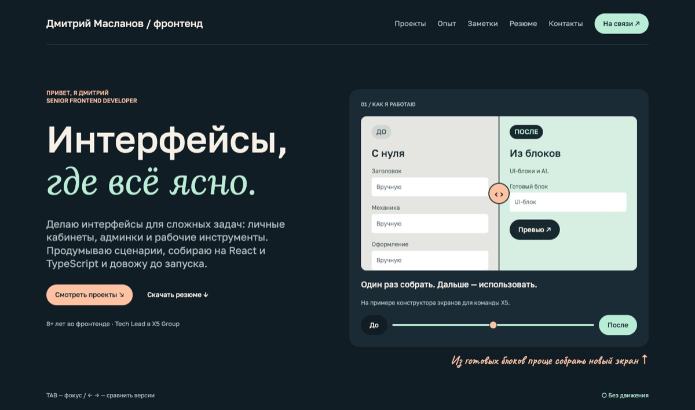

# Дмитрий Масланов · фронтенд

[](https://react.dev/)
[](https://vite.dev/)
[](https://tailwindcss.com/)

Сайт-портфолио фронтенд-разработчика. Здесь собраны проекты, опыт работы и резюме. Кейс X5 показывает, как команда собирает новые экраны из готовых компонентов и проверяет их прямо в админке.



## Что на сайте

- **Главная** (`/`) — проекты, опыт и интерактивное сравнение «до/после».
- **Кейс X5** (`/cases/x5-club`) — конструктор интерфейсов, предпросмотр и Storybook.
- **Заметки** (`/notes`) — раздел с темами будущих публикаций.
- **Резюме** (`/resume`) — опыт, навыки и скачивание PDF.

## Локальный запуск

```bash
npm ci
npm run dev
```

Для проверки production-сборки:

```bash
npm run build
npm run preview
```

Готовая сборка лежит в `dist/`. При размещении на статическом хостинге настройте выдачу `index.html` для маршрутов SPA.

Страницы находятся в `src/pages/`, общие компоненты — в `src/components/`. Цвета и шрифты заданы в `src/styles.css`.
